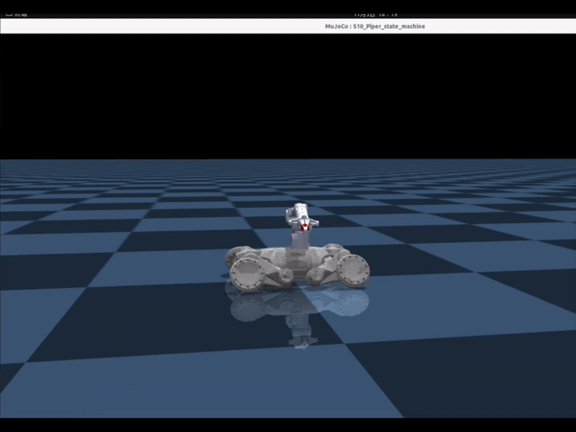
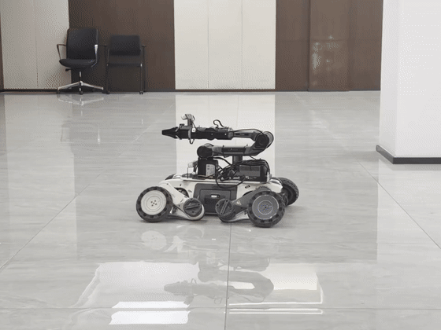
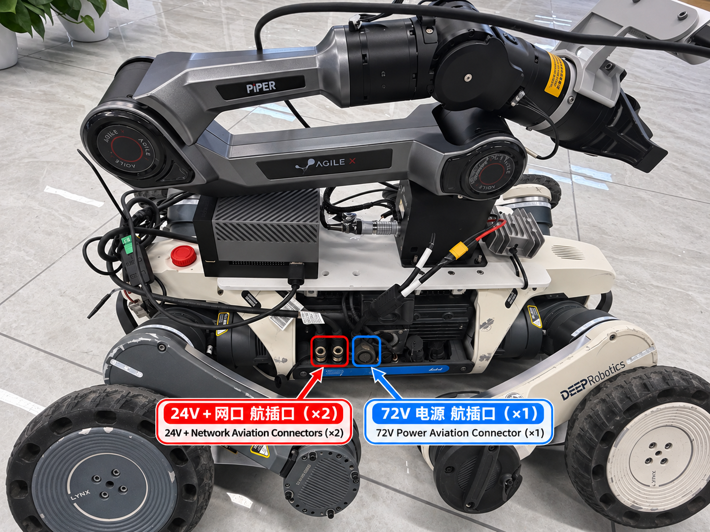
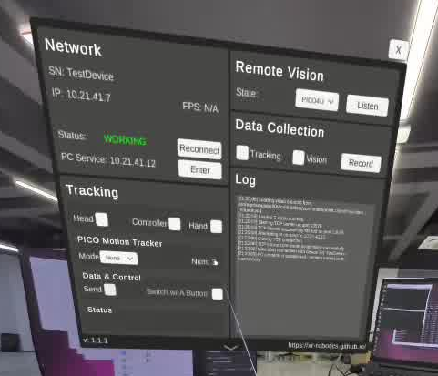
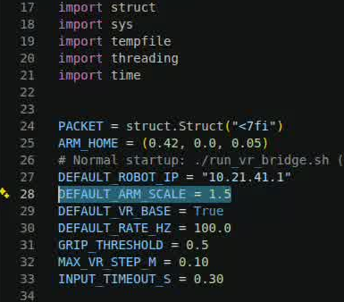

# S10 + Piper 强化学习部署

[](https://github.com/google-deepmind/mujoco)
[](https://docs.ros.org/en/jazzy/)
[](https://www.picoxr.com/)
[](https://en.cppreference.com/w/cpp/17)
[](https://docs.python.org/3.10/)
[](README.md#1-sim-to-sim)
[](README.md#2-sim-to-real)
[](https://discord.gg/gdM9mQutC8)

[English](README_EN.md) | **简体中文**

<table>
  <tr>
    <td align="center"><strong>Sim-to-Sim</strong><br></td>
    <td align="center"><strong>实物演示 1</strong><br><a href="docs/videos/s10_piper_real_demo_2.mp4"></a></td>
    <td align="center"><strong>实物演示 2</strong><br><a href="docs/videos/s10_piper_real_demo_1.mp4"></a></td>
  </tr>
</table>

<p align="center">S10 与 Piper 足臂协同演示（点击实物 GIF 可打开对应 MP4）</p>

将 Piper 机械臂装到 S10 机器狗上，运行足臂协同策略。本项目包含电脑仿真、103 实物部署，以及 Pico VR 控制。先在仿真中熟悉按键，再将同一套操作用到实物。

项目目录为 `S10piper_sim_real`，模型为 `103/rl_deploy/policy/ppo/policy.onnx`，控制程序为 `rl_deploy`。以下按仓库克隆到电脑 home 目录说明；克隆到其他位置时，修改进入项目的路径即可。

## 获取源码

```bash
cd "$HOME"
git clone https://github.com/li269150/S10piper_sim_real.git
cd S10piper_sim_real
```

## 1. Sim-to-Sim

### 配置环境并启动

电脑使用 Ubuntu 22.04 / x86_64，提前安装并初始化 Conda，准备可用的图形桌面及安装系统依赖所需的 sudo 权限。仿真不需要 ROS 2、Piper SDK 或实物连接。首次使用执行：

```bash
cd "$HOME/S10piper_sim_real"  # 进入克隆后的完整项目目录
sudo apt update  # 更新系统软件包索引
sudo apt install -y build-essential cmake python3-dev \
  libgl1 libgl1-mesa-dri libglfw3 libx11-6 libxrandr2 libxinerama1 libxcursor1 libxi6  # 安装编译和图形依赖
conda create -n s10 python=3.10 pip -y  # 创建 Python 3.10 仿真环境，只需执行一次
conda activate s10  # 激活仿真环境
unset PYTHONPATH PYTHONHOME  # 避免当前仿真终端加载系统或 ROS 的 Python 包
python -m pip install -r sim/requirements-lock.txt  # 安装指定版本的仿真依赖
python -m pip check  # 检查依赖是否冲突
cd sim  # 进入仿真目录
./build.sh  # 编译仿真程序，使用 -j20
./run.sh  # 打开仿真，并在当前终端接收键盘输入
```

以后新开终端，只需：

```bash
conda activate s10  # 激活已安装依赖的环境
unset PYTHONPATH PYTHONHOME  # 避免当前仿真终端加载系统或 ROS 的 Python 包
cd "$HOME/S10piper_sim_real/sim"  # 进入仿真目录
./run.sh  # 启动仿真，不需要连接实物
```

没有图形桌面时，在同一 `sim` 目录运行 `./run.sh --headless`。无窗口模式仍需要交互终端：手动按 `z`、`c`，最后 `Ctrl+C` 退出；不会自动进入策略或定时结束。如果 `conda activate` 不可用，先初始化 Bash 的 Conda 并重新打开终端。已有 `s10` 环境时可复用，或使用其他名称创建新环境并同步修改所有激活命令。

### 如何确认启动成功

1. 等待 `[SIM] Arm bridge ready.` 和键盘说明出现；初始状态为蹲姿。
2. 焦点放在**启动终端**，轻按小写 `z`，不需要回车。等待站立轨迹和机械臂运动完成；终端显示 `idle_state -> standup_state`。
3. 轻按小写 `c`，看到 `standup_state -> rl_control` 后再输入机械臂或底盘指令。若未出现该切换，保持底盘停止并查看完整日志。
4. 退出时，等待 `[SIM] Stopped.` 后再启动下一次仿真。

### 键盘怎么控制

焦点放在启动终端，**字母全部输入小写**。先按 `z`，站稳后按 `c`；仿真与实物使用相同按键。

| 按键 | 作用 |
| --- | --- |
| `z` → `c` | `z` 站立；站稳、机械臂到训练初始姿态后，按 `c` 进入策略 |
| `i` / `k` | 机械臂末端目标向前 / 向后 |
| `j` / `l` | 机械臂末端目标向左 / 向右 |
| `u` / `o` | 机械臂末端目标向上 / 向下 |
| `h` | 回训练初始姿态，同时清零底盘指令 |
| `n` / `m` | 打开 / 闭合夹爪 |
| `w` / `s` | 调整底盘前进 / 后退速度，松键不会自动停止 |
| `q` / `e` | 调整底盘左右转向速度 |
| 空格 | 清零底盘速度，不是硬件急停 |
| `Ctrl+C` | 正常退出；实物退出顺序见下文 |

演示时，先小幅按 `o` 观察末端下降和机身降低，再按 `u` 观察末端上升和机身抬高；用 `i/k`、`j/l` 试前后、左右移动。随后小幅输入 `w/s`、`q/e` 观察高低姿态下的底盘运动，按空格停止底盘，最后 `Ctrl+C` 退出。

仿真只使用本机回环通信，不连接实物。完整日志位于 `sim/logs/本次运行目录/run.log`；`state.json` 保存最新状态，`telemetry.json` 在退出时写入。启动和机械臂诊断也可能显示中文。偶发 IK slew-limit 提示表示目标分多帧逐步到达；持续反馈异常、断连或关节限位故障需要排查。

机械臂方向以机器人为参考：+X 向前、+Y 向左、+Z 向上。当前控制器通过 J1–J3 调整末端位置，J4–J6 保持训练 Home 朝向，不提供独立手腕或末端姿态控制。

每按一次 `w/s`，前后指令变化 0.05；每按一次 `q/e`，转向指令变化 0.20。前后指令会清零转向，转向指令会清零前后，两者不叠加。底盘横移未开放。机械臂每次按键调整目标 0.02m，受工作空间限幅。小幅上下指令可能只改变姿态，机身高度变化不一定明显。空格只清零底盘速度目标；当前策略在零指令下仍可能漂移，不提供位置保持。

窗口未出现时，检查图形桌面或显示连接，也可用 `--headless`。若 `pip check` 报告不相关的 ROS 依赖，确认当前仿真终端已清除 `PYTHONPATH` 和 `PYTHONHOME`。本地端口占用时，先正常退出旧仿真，或用 `./run.sh --port-base 12880`。默认本地端口为 UDP 11880/11882 和 TCP 11999。

## 2. Sim-to-Real

### 各设备运行什么

| 设备 | 所需环境 | 文件与作用 |
| --- | --- | --- |
| 电脑 | 仿真：Ubuntu 22.04 x86_64、Python 3.10；上传：SSH/SCP | 克隆完整仓库，本地运行 `sim/`，按下文上传子目录。 |
| S10 控制器（103） | ARM64、预装 ROS 2 Jazzy、C++17 编译器、CMake、`colcon` 及正常的厂家 SDK/DDS 访问 | `/home/user/rl_deploy`：策略和 S10 控制程序。 |
| Orin | Python 3.10、NumPy、Piper SDK 0.6.1、CAN 工具与权限；VR 还需 PXREA 服务及 SDK | `/home/user/piper`：机械臂服务；`/home/user/pico_bridge`：VR 桥接。 |

`103` 是本文对机载控制器的称呼，不是额外一台电脑，也不要求 IP 最后一段为 103。下文 `user` 和 `/home/user` 为示例远程账号与路径，需要同时替换为各设备的实际账号和 home 目录。电脑仿真安装步骤不会为控制器或 Orin 安装依赖。

### 安装与连接

先固定好 Piper、Orin 和线束。实物部署前，按厂家文档准备好 S10 的 SDK、通信环境及控制权限，并在 Orin 上安装 Piper SDK 和相关依赖。

讲稿中的样机，侧面三个航插从左到右为两路集成网口的 24V 接口和一路 72V 接口；Piper 使用 24V 供电，Orin 经 72V 转 19V 稳压模块供电。测试时确保机器狗安全支撑、机械臂完整路径无人、急停可用。



*图 1　样机的两路 24V 加网口航插与一路 72V 电源航插；用户必须以自己设备的接口定义为准。*

本项目使用的 3D 打印结构件也随包开源，文件位于 `docs/3d_print/`。其中 `leige3Ddayin.SLDPRT` 是 SolidWorks 零件源文件，用于辅助在 S10 上固定 Orin、Piper 机械臂及相关部件。打印和安装前，请根据自己的设备核对尺寸、紧固件、间隙和承载能力。

本说明采用讲稿中的 Wi-Fi 方案：电脑与 Orin 都连接机器狗热点；103 运行策略，Orin 控制机械臂。Piper 与 Orin 通过 USB-CAN / SocketCAN 通信。

```text
电脑 ──SSH / SCP──> 103：运行策略 ──ROS 2 / drdds──> S10 腿轮
                          └──TCP 9999──> Orin ──CAN──> Piper
Pico ──机器狗 Wi-Fi──> Orin：VR 桥接 ──TCP 8089──> 103
```

电脑和 Orin 在各自终端连接热点，已连接时跳过；热点名称和密码以自己的设备为准：

```bash
sudo nmcli radio wifi on  # 开启 Wi-Fi
sudo nmcli --ask device wifi connect "你的机器狗热点名称"  # 连接热点，按提示输入密码
```

下文使用样机地址：103 为 `10.21.33.103`，Orin 为 `10.21.41.12`。**其中 `10.21.41.12` 是作者当前样机的 Orin IP，不是通用地址；用户必须替换为自己 Orin 在机器狗网络中的实际 IP，包括下面所有 SSH、SCP、XRoboToolkit 和配置文件中的地址。** 使用默认 SSH 22 端口，按提示输入各自设备的账号密码，不要求预先配置密钥。首次连接核对设备指纹；换设备先修改文末列出的地址配置。

### 传文件到 103 和 Orin

在电脑上另开终端，进入完整项目根目录上传。远程已有同名目录时先备份，不覆盖正在使用的环境。

```bash
cd "$HOME/S10piper_sim_real"  # 进入电脑上的项目根目录
scp -r 103/rl_deploy user@10.21.33.103:/home/user/  # 将控制程序源码传到 103
scp -r orin/piper user@10.21.41.12:/home/user/  # 将机械臂服务源码传到 Orin
```

启动任何程序前，按第 4 节修改 `103/rl_deploy/deploy.conf`、`orin/piper/deploy.conf`；VR 还需修改 `orin/pico_bridge/s10_piper_vr_bridge.py` 的 `DEFAULT_ROBOT_IP`。可以上传前修改，也可上传后在各远端修改。确认 103 能访问 Orin 的 TCP 9999，Orin 白名单包含 103 实际使用的来源 IP，VR 时 Orin 能访问 103 的 TCP 8089。`PIPER_CAN_PORT=can2` 是样机 CAN 口，不是自动探测出的通用默认值。

随后在电脑打开两个终端，分别登录；后续编译和运行命令在对应远端终端执行。

```bash
# 电脑终端一
ssh user@10.21.33.103  # 登录 103，运行策略和键盘或 VR 控制
```

```bash
# 电脑终端二
ssh user@10.21.41.12  # 登录 Orin，运行机械臂服务
```

### 在 103 编译

103 使用已有的 ROS 2 Jazzy 和编译环境。厂家 `drdds` 接口源码位于 `vendor/drdds`，脚本将它编译到项目目录，不写入 `/opt/ros`。

```bash
cd /home/user/rl_deploy  # 进入传到 103 的控制程序目录
./build.sh  # 使用 -j20 编译 drdds、键盘版和 VR 版
```

编译结果分别位于 `install_drdds`、`install` 和 `install_vr`。103 的 ARM64 程序需要在 103 编译，不能直接使用电脑上的仿真程序。只编 VR 可执行 `./build.sh vr`；只编键盘版可执行 `./build.sh realtime`。

### 在 Orin 启动机械臂服务

在用户自己的 Orin 上准备 Python 3.10、numpy、Piper SDK（本包按 `piper_sdk==0.6.1` 对接）、CAN 工具和正确的 CAN 配置。Piper SDK 请从[松灵机器人官方 Piper SDK 仓库](https://github.com/agilexrobotics/piper_sdk)获取，并按官方说明安装依赖、核对机械臂固件与接口版本；本包不附带 Piper SDK 源码。

```bash
cd /home/user/piper  # 进入 Orin 上的机械臂服务目录
./start_s10_piper_layered_server_realtime.sh  # 启动机械臂服务，收到有效反馈后低速回零
```

等待机械臂先 J1/J2、再 J3–J6 回机械零位，回零完成后保持该终端运行。它接收 103 发来的目标，并向 103 返回机械臂状态。若反馈异常，先排查 CAN、SDK 和接线，不继续站立或进入策略。

### 在 103 运行键盘控制

```bash
cd /home/user/rl_deploy  # 进入 103 控制程序目录
./run.sh  # 启动键盘版，并申请实物 SDK 控制权
```

确认 SDK 和反馈正常，按 `z` 站立；等机器狗站稳、机械臂到训练初始姿态，再按 `c` 进入策略。操作与仿真相同：`i/k` 前后、`j/l` 左右、`u/o` 上下、`h` 回训练初始姿态、`n/m` 开合夹爪；`w/s` 前后速度、`q/e` 转向，空格清零底盘指令。

正常结束，**先在 103 控制终端按 `Ctrl+C`**，等待机器狗完成蹲下、机械臂回零及 SDK 退出，再关闭 Orin 机械臂服务。直接在 Orin 终端按 `Ctrl+C` 不会执行回零。遇到危险使用硬件急停，不依赖正常退出流程。

## 3. Pico 虚拟现实控制

### 首次安装与方向校准

启动桥接前，先在 Pico 安装并授权 XRoboToolkit，在 Orin 安装并授权 PXREA RoboticsService 及 ARM64 SDK。启动脚本默认使用 `/opt/apps/roboticsservice/runService.sh`；桥接查找 `/opt/apps/roboticsservice/SDK/arm64/libPXREARobotSDK.so`（也检查 x64 SDK 路径）。安装位置不同，需修改启动脚本的 `PXREA_SERVICE_ROOT`，并通过 `PXREA_SDK_LIB` 指定匹配架构的库。

随包 `vr_axes.json` 是参考校准，首次使用、Pico 重新居中或操作者朝向改变后应重新校准。先停止 103 控制程序和 Piper 机械臂服务，保持机械臂失能；连接 Pico 与 XRoboToolkit，勾选 `Controller` 和 `Send`，再在 Orin 执行：

```bash
cd /home/user/pico_bridge
./run_vr_bridge.sh --self-test  # 离线检查 JSON、坐标轴及协议，不连接实物
./run_vr_bridge.sh --calibrate-right  # 只读取手柄数据，不连接 103
```

按提示保持面向操作方向：松开右 Grip，按住 Grip 向自己的右侧水平移动 10～20cm，稳住一秒后松开；松开 Grip 后移回，再重复一次向右动作。等待校准成功并保存 `vr_axes.json`。随后按第 2 节启动机械臂服务，再按下文正常启动。

### 启动顺序

先正常退出 103 键盘程序，保持 Orin 机械臂服务运行。键盘版和 VR 版一次只运行一个；103 的 `./build.sh` 不带参数会编译两种模式，也可以用 `./build.sh vr` 或 `./build.sh realtime` 单独编译。

首次使用，在电脑项目根目录上传桥接程序：

```bash
cd "$HOME/S10piper_sim_real"  # 进入电脑上的完整项目目录
scp -r orin/pico_bridge user@10.21.41.12:/home/user/  # 将 VR 桥接传到 Orin
```

在电脑另开一个终端登录 Orin，启动 VR 桥接：

```bash
ssh user@10.21.41.12  # 另开 Orin 终端，不关闭机械臂服务
cd /home/user/pico_bridge  # 进入 VR 桥接目录
./run_vr_bridge.sh  # 接收手柄数据并发送到 103，默认倍率 1.0
```

Pico 连接机器狗 Wi-Fi，打开 XRoboToolkit，连接用户自己 Orin 的实际 IP（图中作者样机为 `10.21.41.12`）。确认 Network 显示绿色 `WORKING`，勾选 `Controller` 和 `Send`；完成这些 Pico 设置后，在 103 启动 VR 版。桥接仅在收到新鲜手柄数据后连接 103；启动期间可以等待 103 的监听程序就绪：



*图 2　XRoboToolkit 的连接状态示例；PC Service 地址应改为用户自己的 Orin IP。*

```bash
cd /home/user/rl_deploy  # 进入 103 控制程序目录
./run_vr.sh  # 启动 VR 版控制程序
```

确认 103 显示 `[VR] listening TCP 0.0.0.0:8089`，Orin 显示 `[PXREA Bridge] connected to 103 at ...:8089`。在 103 终端按 `z` 站立，站稳后按 `c` 进入策略。先让摇杆回中，小幅试动右手确认方向，再进行演示。XRoboToolkit 的安装和使用参考 [官方网站](https://xr-robotics.github.io/)，这里不展开。Orin 需按官方授权另行安装 PXREA RoboticsService 到 `/opt/apps/roboticsservice`；本包不附带该服务、SDK、动态库或 Pico APK。

### 手柄怎么控制

| 操作 | 作用 |
| --- | --- |
| 左摇杆前后 | 控制底盘前进、后退 |
| 左摇杆左右 | 控制底盘转向 |
| 按住右 Grip，再移动手柄 | 调整机械臂相对位置；松开后目标保持 |
| 按下 / 松开右 Trigger | 打开 / 闭合夹爪，默认闭合 |
| 右 B | 回训练初始姿态、清零底盘指令，并将当前手柄位置设为新的位置原点；不改变方向校准 |

机械臂左右运动与前后、上下采用分组控制：左右运动时保持 X/Z 目标，前后或上下运动时保持 Y 目标。松开再按住 Grip 可重设相对运动参考。VR 数据超过 300ms 未更新时，停止底盘指令并冻结机械臂目标，但这不是硬件急停。结束时仍先在 103 终端按 `Ctrl+C`，等待退出完成后再关闭 Orin 服务。

### 倍率和坐标映射在哪改

修改 Orin 上 `/home/user/pico_bridge/s10_piper_vr_bridge.py` 文件开头：

```python
DEFAULT_ARM_SCALE = 1.0  # 手移动 10cm，机械臂目标约移动 10cm
```



*图 3　`DEFAULT_ARM_SCALE` 在桥接脚本中的位置。*

改为 `2.0`，即手移动 10cm，目标约移动 20cm。保存后停止并重新运行 `./run_vr_bridge.sh`，不需要编译，也不需要在命令后加参数。

倍率影响的是**目标位移，不是电机速度**；机械臂仍受工作空间和限速约束。坐标方向转换在同文件的 `vr_delta_to_robot()`，方向校准数据在同目录的 `vr_axes.json`。若方向不对，先检查坐标映射和校准，不靠增加倍率解决。

## 4. 换设备改哪里

日常只运行上述脚本，不需要手动 `export` 或在命令后加地址、倍率参数。修改配置后重启对应程序。

| 文件 | 修改内容 |
| --- | --- |
| `103/rl_deploy/deploy.conf` | `PIPER_SERVER_IP`：103 能访问的 Orin 地址；机械臂服务默认端口 9999 |
| `orin/piper/deploy.conf` | `PIPER_CAN_PORT`：实际 CAN 口；服务端口；`PIPER_ALLOWED_IPS`：允许接入的 103 地址 |
| `orin/pico_bridge/s10_piper_vr_bridge.py` 开头 | `DEFAULT_ROBOT_IP`：103 地址，样机为 `10.21.41.1`；`DEFAULT_ARM_SCALE`：位移倍率；`DEFAULT_VR_BASE`：摇杆底盘控制开关 |
| `orin/pico_bridge/vr_axes.json` | 手柄方向校准 |

样机 `10.21.33.103` 与 `10.21.41.1` 是 103 的不同网段地址，均须以实际设备网络为准。以上为 Wi-Fi 示例，代码通过 IP 通信，不强制网卡类型；换为有线连接时，同样需配置两端可达的地址。

## 项目结构

```text
S10piper_sim_real/
├── 103/                         # S10 机载 103 控制器部署文件
│   └── rl_deploy/               # 策略模型、控制源码、编译和运行脚本
├── orin/                        # Orin 侧程序
│   ├── piper/                   # Piper CAN 通信、回零和实时控制服务
│   └── pico_bridge/             # Pico 手柄数据接收与 VR 指令桥接
├── sim/                         # 电脑端 MuJoCo 仿真、环境依赖和启动脚本
├── docs/                        # README 使用的项目文档资源
│   ├── images/                  # 演示动画、硬件照片和操作截图
│   ├── videos/                  # 实物演示 GIF 和 MP4
│   └── 3d_print/                # 3D 打印结构件源文件
├── verification/                # 来源说明及离线发布包完整性校验
├── README.md                    # 中文部署说明
└── README_EN.md                 # 英文部署说明
```


## 训练参考

本仓库只提供部署、仿真和运行脚本，不包含训练代码。想了解足臂协同强化学习的整体思路，可参考 [Deep Whole-Body Control](https://github.com/MarkFzp/Deep-Whole-Body-Control) 及其 [CoRL 论文](https://proceedings.mlr.press/v205/fu23a.html)。
