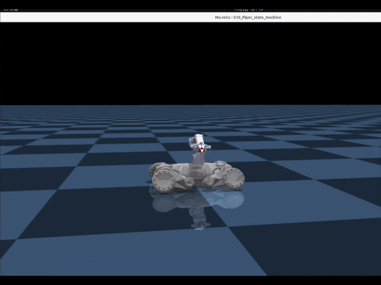
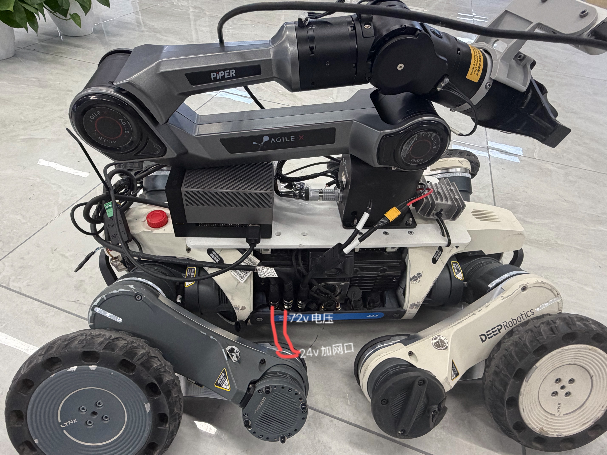
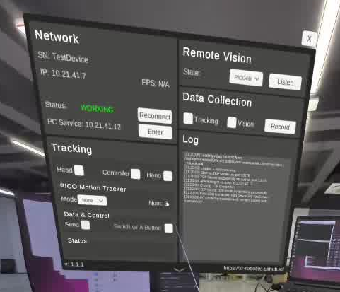
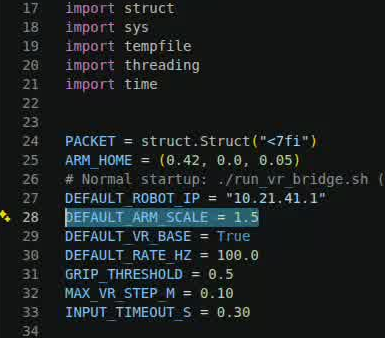

# S10 + Piper Reinforcement-Learning Deployment

English | [简体中文](README.md)

<p align="center">
  
</p>

<p align="center">S10 and Piper coordinated-control demo (muted, 1.2× speed, looping)</p>

```text
S10piper_sim_real/
├── 103/
│   └── rl_deploy/
├── orin/
│   ├── piper/
│   └── pico_bridge/
├── sim/
├── docs/
│   └── images/
├── verification/
├── README.md
├── README_EN.md
└── SHA256SUMS
```

Mount a Piper robotic arm on an S10 quadruped and run a coordinated whole-body policy. This repository includes PC simulation, deployment on the S10 controller (referred to as **103** below), and Pico VR control. Start with simulation to learn the controls, then use the same controls on the real robot.

The project directory is `S10piper_sim_real`, the policy is `103/rl_deploy/policy/ppo/policy.onnx`, and the deployment program is `rl_deploy`. The commands below assume the release package is extracted directly under the PC user's home directory. If you extract it elsewhere, adjust the project path accordingly.

## 1. Simulation

### Set up and run

Use an Ubuntu 22.04 x86_64 PC with Conda installed and initialized. Run these commands once:

```bash
cd "$HOME/S10piper_sim_real"  # Enter the extracted project directory
sudo apt update  # Refresh the system package index
sudo apt install -y build-essential cmake python3-dev \
  libgl1 libgl1-mesa-dri libglfw3 libx11-6 libxrandr2 libxinerama1 libxcursor1 libxi6  # Install build and graphics dependencies
conda create -n s10 python=3.10 pip -y  # Create the Python 3.10 simulation environment; run once
conda activate s10  # Activate the simulation environment
python -m pip install -r sim/requirements-lock.txt  # Install the pinned simulation dependencies
python -m pip check  # Check for Python dependency conflicts
cd sim  # Enter the simulation directory
./build.sh  # Build the simulation with -j20
./run.sh  # Start the simulation and accept keyboard input in this terminal
```

For later sessions, only run:

```bash
conda activate s10  # Activate the existing environment
cd "$HOME/S10piper_sim_real/sim"  # Enter the simulation directory
./run.sh  # Start simulation; no real hardware is required
```

### Keyboard controls

Keep focus on the terminal that launched the program and use **lowercase letters**. Press `z` first; after the robot is standing, press `c`. Simulation and real-hardware modes use the same keys.

| Key | Action |
| --- | --- |
| `z` → `c` | `z`: stand up. After the robot is stable and the arm reaches its training home pose, press `c` to enter policy control. |
| `i` / `k` | Move the arm end-effector target forward / backward. |
| `j` / `l` | Move the arm end-effector target left / right. |
| `u` / `o` | Move the arm end-effector target up / down. |
| `h` | Return to the training home pose and clear the base command. |
| `n` / `m` | Open / close the gripper. |
| `w` / `s` | Increase forward / backward base speed. Releasing the key does not stop the base. |
| `q` / `e` | Adjust left / right yaw speed. |
| Space | Clear the base velocity command. This is not a hardware emergency stop. |
| `Ctrl+C` | Exit normally. See the real-hardware shutdown sequence below. |

For a basic demonstration, tap `o` to lower the end effector and body, then tap `u` to raise them. Try `i/k` and `j/l` for forward/backward and left/right arm motion. Next, apply small `w/s` and `q/e` inputs to observe base motion at different body heights. Press Space to stop the base, then press `Ctrl+C` to exit.

Simulation uses local loopback communication only and does not connect to the real robot. The terminal displays short English status and fault messages. The full log is stored under `sim/logs/<current-run>/run.log`.

## 2. Sim-to-Real Deployment

### Hardware installation and network

Secure the Piper arm, Orin, and all cables before deployment. Follow the manufacturers' documentation to prepare the S10 SDK, communication environment, and control permission. Install the Piper SDK and its dependencies on Orin.

On the reference robot, the three side aviation connectors are two integrated Ethernet/24 V connectors and one 72 V connector. Piper uses 24 V power, while Orin is powered through a 72 V-to-19 V regulator. **This describes the reference robot only and must not be copied blindly. Before wiring, verify the actual pinout, polarity, rated voltage, and converter capacity. Never connect 72 V directly to Piper or Orin.** Keep the robot safely supported, clear the full arm workspace, and keep the hardware emergency stop accessible.



*Figure 1. Installation and power arrangement used in the presentation. Follow the pinout of your own hardware.*

This guide uses the Wi-Fi arrangement from the demonstration: the PC and Orin connect to the robot hotspot, 103 runs the policy, and Orin controls Piper. Piper communicates with Orin through USB-CAN / SocketCAN.

```text
PC ──SSH / SCP──> 103: policy ──ROS 2 / drdds──> S10 legs and wheels
                         └──TCP 9999──> Orin ──CAN──> Piper
Pico ──robot Wi-Fi──> Orin: VR bridge ──UDP 8089──> 103
```

Connect the PC and Orin to the hotspot in their respective terminals. Skip this step if already connected. Replace the SSID and password with those of your robot:

```bash
sudo nmcli radio wifi on  # Enable Wi-Fi
sudo nmcli --ask device wifi connect "YOUR_ROBOT_HOTSPOT"  # Connect and enter the password when prompted
```

The reference addresses below are `10.21.33.103` for 103 and `10.21.41.12` for Orin. **`10.21.41.12` is the author's current reference-Orin address, not a universal default. Replace it with the actual address of your own Orin on the robot network everywhere below, including SSH, SCP, XRoboToolkit, and configuration files.** The examples use the default SSH port 22 and prompt for each device's account password; preconfigured SSH keys are not required. Verify the host fingerprint on the first connection. For another robot, update the configuration files listed in Section 4.

### Copy files to 103 and Orin

Open a terminal on the PC, enter the complete project directory, and upload the source. If a directory with the same name already exists remotely, back it up first instead of overwriting a running environment.

```bash
cd "$HOME/S10piper_sim_real"  # Enter the project root on the PC
scp -r 103/rl_deploy user@10.21.33.103:/home/user/  # Upload the deployment source to 103
scp -r orin/piper user@10.21.41.12:/home/user/  # Upload the arm service to Orin
```

Then open two PC terminals and log in to each device. Run all later build and launch commands in the corresponding remote terminal.

```bash
# PC terminal 1
ssh user@10.21.33.103  # Log in to 103 for policy, keyboard, or VR control
```

```bash
# PC terminal 2
ssh user@10.21.41.12  # Log in to Orin for the arm service
```

### Build on 103

103 uses its existing ROS 2 Jazzy and compiler environment. The vendor `drdds` interface source is stored in `vendor/drdds`; the build script installs it inside the project directory and does not modify `/opt/ros`.

```bash
cd /home/user/rl_deploy  # Enter the deployment directory uploaded to 103
./build.sh  # Build drdds, keyboard mode, and VR mode with -j20
```

The build outputs are stored in `install_drdds`, `install`, and `install_vr`. The ARM64 program must be built on 103; the x86_64 simulation executable from the PC cannot be reused on 103.

### Start the arm service on Orin

On your own Orin, prepare Python 3.10, NumPy, Piper SDK (this package targets `piper_sdk==0.6.1`), CAN utilities, and a valid CAN configuration. Obtain Piper SDK from the [official AgileX Robotics Piper SDK repository](https://github.com/agilexrobotics/piper_sdk), follow its installation instructions, and confirm that the arm firmware and SDK interface version are compatible. The Piper SDK source is not bundled in this repository.

```bash
cd /home/user/piper  # Enter the arm-service directory on Orin
./start_s10_piper_layered_server_realtime.sh  # Start the service and perform a low-speed homing sequence after valid feedback is received
```

Wait for J1/J2 to return to the mechanical zero, followed by J3-J6. Leave this terminal running after homing completes. The service receives targets from 103 and returns arm state to 103. If feedback is abnormal, stop and check CAN, the SDK, and wiring before standing the robot or entering policy control.

### Run keyboard control on 103

```bash
cd /home/user/rl_deploy  # Enter the deployment directory on 103
./run.sh  # Start keyboard mode and request the real-robot SDK control lease
```

After the SDK and feedback are healthy, press `z` to stand. Once the robot is stable and the arm reaches its training home pose, press `c` to enter policy control. The controls are identical to simulation: `i/k` forward/backward, `j/l` left/right, `u/o` up/down, `h` training home, `n/m` gripper open/close, `w/s` base forward/backward speed, `q/e` yaw, and Space to clear the base command.

To stop normally, **press `Ctrl+C` in the 103 control terminal first**. Wait for the robot to crouch, the arm to return, and the SDK to exit before stopping the Orin arm service. Pressing `Ctrl+C` directly in the Orin terminal does not home the arm. In an emergency, use the hardware emergency stop instead of the normal shutdown sequence.

## 3. Pico VR Control

### Startup sequence

Exit the 103 keyboard program normally and keep the Orin arm service running. Keyboard and VR modes are mutually exclusive. The default `./build.sh` command builds both modes.

For first-time use, upload the bridge from the PC project root:

```bash
cd "$HOME/S10piper_sim_real"  # Enter the complete project directory on the PC
scp -r orin/pico_bridge user@10.21.41.12:/home/user/  # Upload the VR bridge to Orin
```

Open another PC terminal, log in to Orin, and start the VR bridge:

```bash
ssh user@10.21.41.12  # Open a second Orin session; keep the arm-service terminal running
cd /home/user/pico_bridge  # Enter the VR bridge directory
./run_vr_bridge.sh  # Receive controller tracking and forward commands to 103; default scale is 1.5
```

Connect Pico to the robot Wi-Fi, open XRoboToolkit, and connect to the actual IP of your own Orin (`10.21.41.12` is only the reference address shown in the figure). Confirm that Network shows green `WORKING`, then enable `Controller` and `Send`. After Orin receives controller tracking data, start VR mode on 103:



*Figure 2. XRoboToolkit connection example. Replace the PC Service address with the IP of your own Orin.*

```bash
cd /home/user/rl_deploy  # Enter the deployment directory on 103
./run_vr.sh  # Start VR control
```

Press `z` in the 103 terminal, wait for the robot to stand, then press `c` to enter policy control. Center the joysticks and test the right controller with small movements before a full demonstration. For XRoboToolkit installation and operation, refer to the [official website](https://xr-robotics.github.io/). Orin also requires the officially licensed PXREA RoboticsService under `/opt/apps/roboticsservice`. This repository does not include that service, its SDK or shared libraries, or a Pico APK.

### VR controls

| Input | Action |
| --- | --- |
| Left joystick forward/backward | Drive the base forward/backward. |
| Left joystick left/right | Turn the base left/right. |
| Hold right Grip and move the controller | Move the arm target relative to the current reference; releasing Grip holds the target. |
| Press/release right Trigger | Open/close the gripper; closed is the default. |
| Right B | Return to the training home pose, clear the base command, and set the current controller position as the new position origin. Direction calibration is unchanged. |

Lateral motion is grouped separately from forward/backward and vertical motion. If VR data is not updated for more than 300 ms, the bridge stops the base command and freezes the arm target. This is not a hardware emergency stop. To finish, press `Ctrl+C` in the 103 terminal first and wait for a clean shutdown before stopping the Orin services.

### Change VR scale and coordinate mapping

Edit `/home/user/pico_bridge/s10_piper_vr_bridge.py` on Orin near the top of the file:

```python
DEFAULT_ARM_SCALE = 1.5  # 10 cm of hand motion produces about 15 cm of arm-target motion
```



*Figure 3. Location of `DEFAULT_ARM_SCALE` in the bridge script.*

For example, change it to `2.0` for approximately 20 cm of arm-target motion from 10 cm of hand motion. Save the file, stop the bridge, and restart `./run_vr_bridge.sh`. No compilation or command-line suffix is required.

The scale changes **target displacement, not motor speed**. Workspace and rate limits still apply. Coordinate conversion is implemented in `vr_delta_to_robot()` in the same file, while direction calibration is stored in `vr_axes.json` in the same directory. If an axis is reversed, fix the mapping or calibration instead of increasing the scale.

## 4. Configuration for Another Robot

Normal operation uses the short launch commands shown above. Do not add manual `export` statements, addresses, or scale arguments to every launch command. Change the configuration once, then restart the corresponding program.

| File | Setting |
| --- | --- |
| `103/rl_deploy/deploy.conf` | `PIPER_SERVER_IP`: Orin address reachable from 103. The default arm-service port is 9999. |
| `orin/piper/deploy.conf` | `PIPER_CAN_PORT`: actual CAN interface; service port; `PIPER_ALLOWED_IPS`: permitted 103 addresses. |
| Top of `orin/pico_bridge/s10_piper_vr_bridge.py` | `DEFAULT_ROBOT_IP`: 103 address (`10.21.41.1` on the reference robot); `DEFAULT_ARM_SCALE`: motion scale; `DEFAULT_VR_BASE`: joystick base-control switch. |
| `orin/pico_bridge/vr_axes.json` | Controller-axis calibration. |

`10.21.33.103` and `10.21.41.1` are addresses of the same 103 controller on different subnets on the reference robot. Always use addresses that match the actual robot network. The examples use Wi-Fi, but the software communicates by IP and does not require a specific network-interface type; a wired setup only needs mutually reachable addresses.

## Notes

Leg gains are Kp/Kd = 60/1, and wheel gains are 0/0.4. The policy and control protections are unchanged. A successful simulation run does not prove long-term stability on real hardware.

The directory structure is inspired by [Lite3_rl_deploy](https://github.com/DeepRoboticsLab/Lite3_rl_deploy). `103/rl_deploy/vendor/drdds` is based on the official DEEPRobotics `deep-robotics-msg` package and retains its BSD-3-Clause license. Redistribution rights for the model, meshes, and other third-party dependencies must be reviewed separately. Never publish device passwords, private keys, or licensed software. See [verification/ORIGIN.md](verification/ORIGIN.md) for provenance and validation limits.
